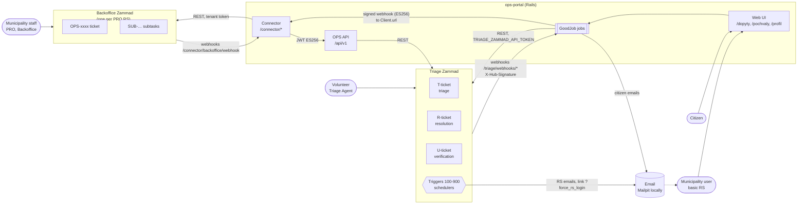

# 01 Overview

## System map

Key points:

- Triage never talks to a Backoffice directly. Everything goes
  Triage → portal → Connector (same Rails app) → Backoffice, and back through
  the OPS API.
- The portal is not the source of truth for issue state. A volunteer sets
  `ops_state` in Triage, and the portal copies it on every `ticket.updated`
  webhook (`app/jobs/triage/update_portal_issue_from_triage_job.rb`).
- The portal itself changes state only for actions in its own UI (RS
  comment, RS reassign/refer, citizen verification), and pushes them to
  Triage (`SyncIssueToTriageJob`).

## Actors

| Actor | Where they act | Identity | Notes |
|---|---|---|---|
| Anonymous visitor | Portal | `AnonymousUser` | Browse, search, map |
| Citizen | Portal | `User::Citizen` (Rodauth: password, Google, Facebook) | Writes need a verified phone (`full_access?`) and a finished onboarding |
| Municipality user, basic RS | Portal + email | `User::ResponsibleSubject`, email magic link only | Created from Triage (organization membership), see [08](08-onboarding.md) |
| Volunteer | Triage | Zammad Agent, group access, ticket owner | Sees only groups they belong to |
| Volunteer admin | Triage | role "Administrátor dobrovoľníkov" | Can change the owner |
| Triage admin | Triage | Zammad Admin | |
| Municipality staff, PRO RS | Backoffice | Agent; "Správca podnetov pre OPS" may talk publicly and change state / RS | |
| Portal tech account | Triage + Backoffice | "Aplikácia Odkaz pre starostu" (Triage user id 5) | API token; gets every group every 15 min |
| Admin (portal) | Portal | email in `ADMIN_EMAILS` (any user in dev) | `/admin/good_job`, `/admin/municipality_boundaries` |

How a portal person appears in Triage **(observed)**:

| Portal | Triage login | Triage role |
|---|---|---|
| Citizen #2 | `ops-user-2` | Portal User (customer) |
| Responsible subject #30 | `ops-rs-30` | Zodpovedný Subjekt |
| Municipality email users | their email, organization = RS name | Externý zodpovedný subjekt (first user), Customer (others) |

## Ticket kinds in Triage

One portal issue maps to up to three Zammad tickets:

| Number | `process_type` | When | Portal column |
|---|---|---|---|
| `T-<issue id>` | `portal_issue_triage` | On submit | `issues.triage_external_id` |
| `R-<issue id>` | `portal_issue_resolution` | When the volunteer accepts (`sent_to_responsible` + RS). T is closed and R is linked as its child | `issues.resolution_external_id` |
| `U-<update id>` | `portal_issue_verification` | Citizen or RS posts an update / "mark as resolved" | `issues_updates.external_id` |

`Issue#triage_process?` is simply `resolution_external_id.nil?`
(`app/models/issue.rb:125-131`).

## Basic vs PRO responsible subject

| | Basic (`pro: false`) | PRO (`pro: true`) |
|---|---|---|
| Works in | Portal (magic-link login) + email | Own Backoffice Zammad |
| Gets new issues by | Triage trigger email to org members with role "Externý zodpovedný subjekt" | Connector creates an `OPS-xxxx` ticket in Backoffice |
| Replies by | Portal (`/dopyty/:id/odpovede`) or replying to the email | Public note in Backoffice |
| Set up by | `bin/rails responsible_subjects:activate_basic` | Deploy Backoffice + `connect_backoffice` console snippet (README) |

## Glossary

| Term | Meaning |
|---|---|
| RS | Responsible subject (zodpovedný subjekt): municipality, district, or other organization |
| `ops_state` | Triage ticket attribute holding the portal state key (`waiting`, `sent_to_responsible`…) |
| Doplnenie | Supplement: volunteer asks the author for more info (`waiting_for_author`) |
| Pochvala | Praise |
| Podúlohy | Subtasks inside Backoffice |
| `[[ops portal]]`, `[[pre zodpovedny subjekt]]` | Tags in Triage article bodies that decide where a comment goes ([06](06-comments-likes-routing.md)) |
| 700 rule | Triage trigger `700 - Priradenie podnetu skupine <Obec> <Agent>` that routes a new ticket to a municipality group, owner and RS |
