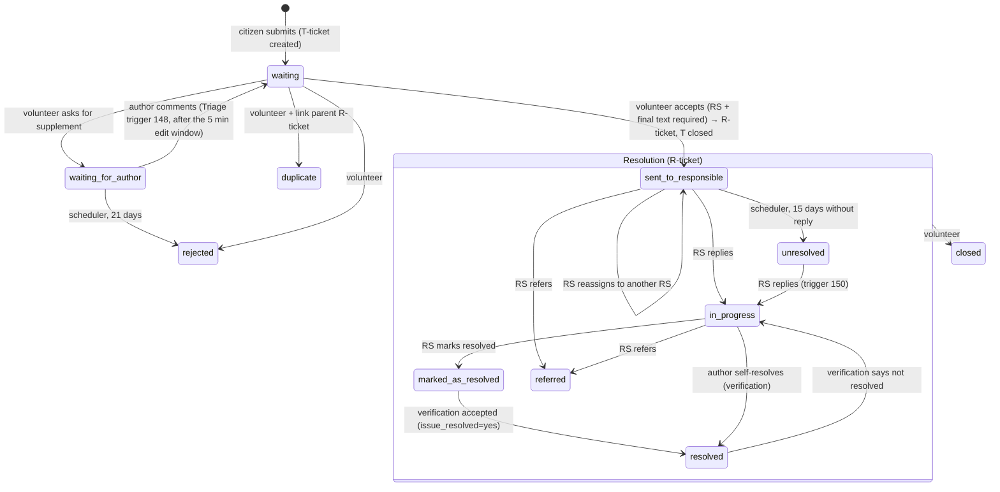
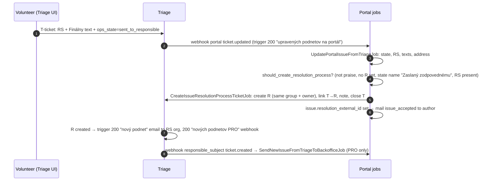

# 02 Issue lifecycle

There is no state machine in code. `Issues::State` is a lookup table and any
code can `update!(state:)`. The Triage attribute `ops_state` holds the same
keys, and the portal copies it on every Triage `ticket.updated`
(`app/jobs/triage/update_portal_issue_from_triage_job.rb:14-32`).

## States

| Key | Name (UI) | Public on portal | Set by |
|---|---|---|---|
| `waiting` | Čakajúci | no | Submit; Triage trigger 148 after the author replies |
| `waiting_for_author` | Čaká na autora | no | Volunteer (request supplement) |
| `rejected` | Zamietnutý | no | Volunteer; Triage scheduler after 21 days in `waiting_for_author` |
| `duplicate` | Duplicitný | no | Volunteer + parent link |
| `resolved_private` | Vyriešený (skrytý) | no | Praise accepted as private (Triage `unresolved` → portal `resolved_private`) |
| `sent_to_responsible` | Zaslaný zodpovednému | yes | Volunteer accept; RS reassignment; Backoffice RS change |
| `in_progress` | V riešení | yes | First RS reply (portal or Triage trigger 150) |
| `referred` | Odstúpený | yes | RS "refer" in portal; `[[odstupene]]` tag in an RS email |
| `marked_as_resolved` | Označený za vyriešený | yes | RS "mark resolved" in portal; `[[vyriesene]]` tag |
| `resolved` | Vyriešený | yes | Verification accepted with `issue_resolved=yes`; author self-resolve; praise accepted public |
| `unresolved` | Neriešený | yes | Triage scheduler 15 days after `sent_to_responsible` with no reply |
| `closed` | Uzavretý | yes | Volunteer |
| `archived` | Archivovaný | (separate) | Legacy import / municipality or RS archived. No runtime flow |

Private keys: `Issues::State::PRIVATE_KEYS` (`app/models/issues/state.rb:14`).
A private issue is visible only to its author (`Issue#viewable_by?`).

## Issue (podnet / otázka)

The diagram shows the intended paths. A volunteer can set any `ops_state`
the core workflow allows (the R-ticket allows all resolution states), and
the portal accepts whatever arrives.

## Who may do what, by state

| State | Author can | RS can | Volunteer can |
|---|---|---|---|
| `waiting` | edit title, description, photos (`Issue#editable_by?`); comment (private) | — | accept / reject / supplement / duplicate |
| `waiting_for_author` | comment (private); **cannot edit** | — | same |
| `rejected` | comment, but Triage trigger 100 answers "Tento tiket je už uzavretý." | — | change it back (no guard) |
| `sent_to_responsible`…`unresolved` | comment (public), like, update / verification | reply, mark resolved, reassign, refer | anything in the R core workflow |
| `resolved`, `closed` | comment, update | blocked from reassign/refer once resolved (`issues_responsible_subject_changes_controller.rb:65-67`) | anything |

## Process switch

Code: `app/jobs/triage/create_issue_resolution_process_ticket_job.rb`,
`app/models/issue.rb:185-193`.
