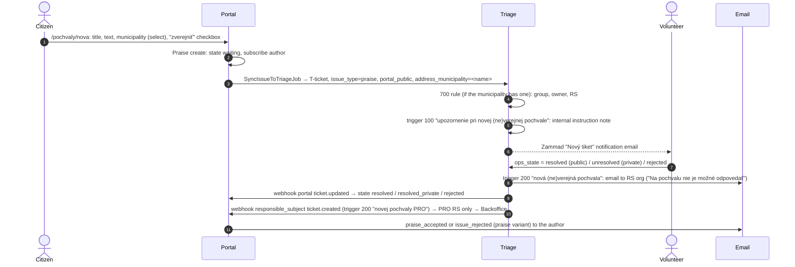

# 05 Praise (pochvala)

A praise is an `Issue` with `issue_type: praise` (`app/models/praise.rb`). It
uses the triage process and never gets an R-ticket.

## Flow (observed)

Observed on 2026-10-15 with "FLOWDOC pochvala Rajec": T-300304 landed in group
Rajec with owner and RS pre-set by the 700 rule. After `resolved`, the
portal showed `resolved` + public, `podatelna@rajec.sk` got the email in
Mailpit, and `SendNewIssueFromTriageToBackofficeJob` ran and stopped because
Rajec is not PRO.

## What Triage sets on a praise

This answers the team's open question. Set by `create_ticket_from_issue!`
(`app/lib/zammad_api_client.rb:125-183`):

| Field | Value |
|---|---|
| `process_type` | `portal_issue_triage` |
| `issue_type` | `praise` |
| `ops_state` | `waiting` |
| `portal_public` | the author's checkbox |
| `address_municipality` | municipality name only (no coordinates, address, category or photos) |
| `responsible_subject` | empty; the 700 rule fills it for a basic municipality |
| group / owner | `Incoming` / none, until a 700 rule matches |

Core workflow in Triage: `issue_type` and `portal_public` are read-only.
`ops_state` offers `waiting, unresolved, resolved, rejected`, and only
`waiting, rejected, unresolved` when not public **(observed)**.

| Volunteer sets | Portal state | Public | Mail to author | RS email |
|---|---|---|---|---|
| `resolved` | `resolved` | yes | `praise_accepted` | "verejná pochvala" |
| `unresolved` | `resolved_private` | no | `praise_accepted` | "neverejná pochvala" |
| `rejected` | `rejected` | no | `issue_rejected` (praise text) | none |

## Edge cases

- **No RS is required.** The "finalisation" core workflow makes RS mandatory
  only for `sent_to_responsible`. A praise accepted without an RS sends the
  RS email to nobody: the recipient override returns nil
  (`ops-triage-zammad/zammad/lib/ops/ticket_perform_changes_action_notification_email_extensions.rb:3-8`).
  It also makes `ResponsibleSubject.find(nil)` raise in
  `Triage::SendNewIssueFromTriageToBackofficeJob` (5 retries).
- **A municipality without a 700 rule** (e.g. Bratislava locally) leaves the
  praise in `Incoming` with no owner, see [03](03-submission-and-triage.md#stuck-in-incoming).
- Switching `resolved` ↔ `unresolved` fires the RS email and the PRO
  webhook again.
- Comments on a praise: the portal never mails them, and the Triage
  instruction note says a praise cannot be commented. Nothing stops a
  citizen from posting one.
- The T-ticket is never closed automatically after a decision.
- A praise set to `sent_to_responsible` (via API; the UI doesn't offer it)
  would stay there forever.
