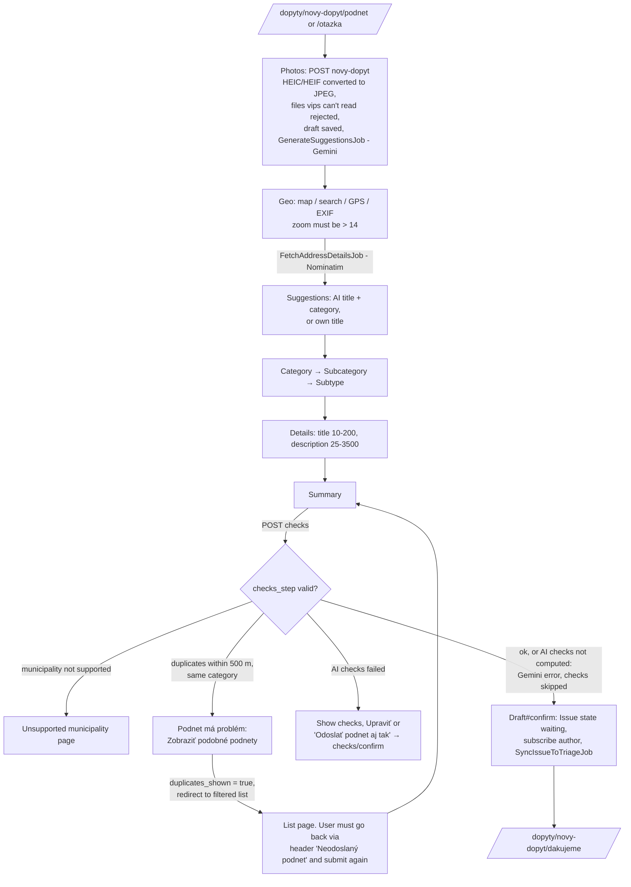
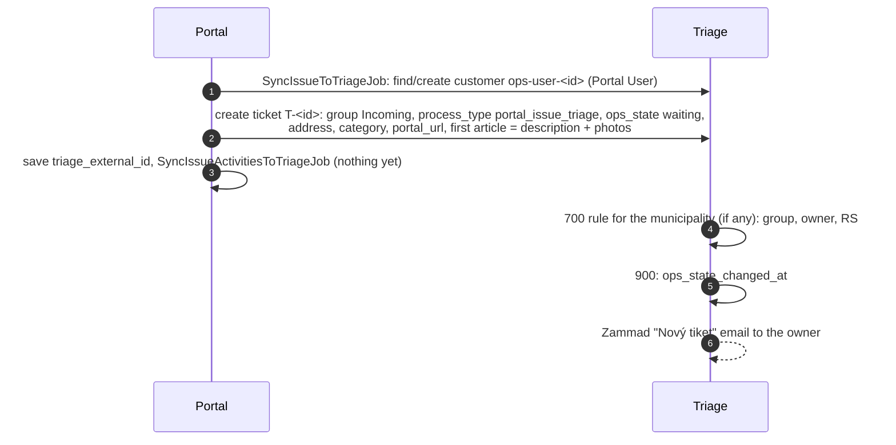
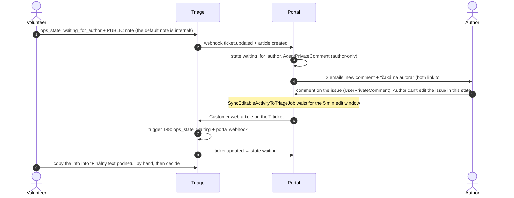

# 03 Submission and triage

## 1. Citizen submits an issue or a question (observed)

Preconditions: logged in, phone verified (`full_access?`), onboarded, under
`USER_ISSUE_CREATION_MONTHLY_LIMIT` (default 10 per month)
(`app/controllers/issues/drafts_controller.rb:4-6,66-68`).

What happens after `Draft#confirm` (`app/models/issues/draft.rb:68-109`):

Observed: "FLOWDOC Rajec chyba lampa" → T-300303, group Rajec, owner
Miroslav Hetteš, RS Rajec (30). "FLOWDOC test nesviet lampa" in Bratislava →
T-300302 stayed in `Incoming`, owner none, RS empty (see below).

The draft is kept. The header button shows "Neodoslaný podnet" while one
exists, and `/dopyty/novy-dopyt/podnet` offers "Zobraziť neodoslaný podnet".

### Stuck in Incoming

Tickets are routed only by the `700 - Priradenie podnetu skupine <Obec> <Agent>`
triggers. They match `address_municipality` **exactly**. When no rule
matches, there is no fallback:

- the ticket stays in group `Incoming` with no owner and no RS,
- volunteers don't have `Incoming` access, so they can't see it
  **(observed: "You are not authorized to open this Tiket")**,
- locally even `admin@example.org` (Admin) lacks `Incoming` group access;
  only the portal tech account has it,
- the portal shows the issue as `waiting` to the author indefinitely, and no
  one is notified.

This hits every active municipality without a 700 rule (locally:
Bratislava, the other seeded municipalities are inactive), city parts
(`Mesto::Časť` tree values never equal `[Obec]`), and any typo or rename.
Who watches `Incoming` in production, and which rules (e.g. 750) cover
PRO cities, is not visible from the repos.

## 2. Volunteer works the T-ticket

The volunteer sees only tickets in their groups. The ticket has two state
fields:

- **Stav v Odkaze pre starostu** (`ops_state`) is the portal state. The
  volunteer accepts, rejects or asks for a supplement here. Every change fires
  the portal webhook.
- **Stav** (Zammad `state_id`: new, open, closed…) is internal to Triage and
  never reaches the portal. Leave it alone: closing T through it doesn't notify
  the author or create the R-ticket. The process switch closes T after accept.

In the triage core workflow, `ops_state` offers **(observed)**:

| Option | Meaning | What follows |
|---|---|---|
| `waiting` Čakajúci | default | — |
| `waiting_for_author` Čaká na autora | request supplement | mail to author, reminders, auto-reject |
| `duplicate` Duplicitný | duplicate | needs a parent R-ticket link |
| `rejected` Zamietnutý | reject | mail to author, system note |
| `sent_to_responsible` Zaslaný zodpovednému | accept | RS and "Finálny text podnetu" become required; R-ticket |

The owner can't be changed once set, except by Admin and "Administrátor
dobrovoľníkov" (core workflows 185/190).

Triage has no subtasks. The `::po` → `[[podulohy]]` / `@@user … - date`
syntax works only in a municipality's Backoffice, see
[07](07-backoffice-connector.md#subtasks-podúlohy).

### 2a. Request supplement (doplnenie) (observed)

Reminders and timeout come from Zammad schedulers, see [10](10-scheduled.md):
a public note at 7 and 14 days, then `rejected` + closed at 21 days.

Observed: author comment posted 00:54:19 → reached Triage 00:59:19 → state
back to `waiting` 00:59:22.

### 2b. Accept (observed)

1. The volunteer sets RS (autocomplete from the portal's unauthenticated
   `/api/v1/responsible_subjects/search`), edits "Finálny text podnetu",
   then `ops_state=sent_to_responsible`. Core workflow 159 makes RS and the
   text mandatory.
2. Then the [process switch](02-issue-lifecycle.md#process-switch) runs:
   R-<id> is created with the same group and owner, T is closed with the
   internal note "Triáž podnetu bola ukončená a bol vytvorený nový tiket
   R-… na jeho vyriešenie".
3. The portal copies the final text into `issues.description` (it overwrites
   the citizen's text), sets the RS and `sent_to_responsible`, and mails the
   author `issue_accepted`.
4. Triage emails the RS organization ("vám priradil podnet") from
   `podnety@triaz.odkazprestarostu.sk` with a link
   `…/dopyty/<id>?force_rs_login`.

Observed jobs: `SyncTicketUpdateFromTriageJob` → `UpdatePortalIssueFromTriageJob`
→ `CreateIssueResolutionProcessTicketJob` → `PublishIssueAcceptedJob` → mail;
then `CreateNewPortalActivityFromTriageJob`,
`SendNewIssueFromTriageToBackofficeJob` (no-op, not PRO) and
`UpdatePortalActivityFromTriageJob`.

### 2c. Reject

The volunteer sets `rejected` (and should add a public note with the reason).
The portal sets `rejected`, posts the system note "Podnet bol zamietnutý." to
Triage (`Triage::CreateRejectionSystemNoteJob`, deduped against the last
article), and mails the author `issue_rejected`, which links to the rules
page. The T-ticket is **not** closed automatically. A later public comment
from the author gets the internal note "Tento tiket je už uzavretý." only
if the ticket is closed (trigger 100).

The team plans to test "doplnenie odmietnutého podnetu" (supplementing a
rejected issue). There is no such flow: a rejected issue can't be edited,
and an author comment doesn't change the state (trigger 148 handles only
`waiting_for_author`). The volunteer has to notice the comment and reopen
by hand.

### 2d. Duplicate

The volunteer sets `duplicate` **and** links the original R-ticket as the
parent (Zammad links). `Triage::ConnectDuplicateIssueFromTriageJob`:

- valid parent: public note on T; the duplicate's text and photos become a
  `DuplicateIssueComment` on the parent issue (synced to R); subscribers are
  copied; author mail `issue_marked_as_duplicate` (no link to the parent);
- no or invalid parent: reverts `ops_state` and adds a note explaining that a
  parent link is needed.

## 3. Author edits while waiting

`/dopyty/:id/edit` is allowed only for the author in `waiting`
(`app/models/issue.rb:147-160`). It re-syncs title, description and photos
(`SyncIssueToTriageJob(sync_activities: false)`). Triage trigger 800 adds the
internal note "Text podnetu bol upravený…". No test covers this.

## 4. Other Triage-side admin work

| Rule family | What | Source |
|---|---|---|
| 100 | Instruction notes (closed ticket commented, new praise) | `ops-triage-zammad/lib/tasks/ops/triage.rake` |
| 148-151 | State flips on replies + webhooks those changes need | same |
| 200 | Forwarding: RS emails, PRO webhooks, portal webhooks, tag-driven states | same |
| 700 | Routing per basic municipality (created by `activate_basic`) | `app/models/responsible_subjects/basic_activation.rb:204-225` |
| 750 (team convention) | Hand-made rules for RS / owner assignment | Only in the Triage DB |
| 800 | Public / internal notes on RS changes, marked resolved, text edits | rake |
| 900 | Timestamps `ops_state_changed_at`, `responsible_subject_changed_at` (set to now + 1 min) | rake |

Zammad triggers run in name order. Changes a trigger makes don't fire
other triggers (`ticket_trigger_recursive` is false), which is why
148/150/151 carry their own webhook actions.

## Open issues

Known problems in this flow, tracked in the private `slovensko-digital/ops` repo. When one is fixed, update the section above in the same PR and remove its row.

| Issue | Section | Problem |
|---|---|---|
| [ops#1320](https://github.com/slovensko-digital/ops/issues/1320) | [Stuck in Incoming](#stuck-in-incoming) | A ticket from a municipality without a 700 rule stays in `Incoming` forever |
| [ops#1322](https://github.com/slovensko-digital/ops/issues/1322) | [1. Citizen submits an issue or a question (observed)](#1-citizen-submits-an-issue-or-a-question-observed) | The duplicate check in the wizard is a dead end |
| [ops#1323](https://github.com/slovensko-digital/ops/issues/1323) | [2c. Reject](#2c-reject) | A rejected issue can't be supplemented |
| [ops#1328](https://github.com/slovensko-digital/ops/issues/1328) | [2a. Request supplement (doplnenie) (observed)](#2a-request-supplement-doplnenie-observed) | Request supplement sends the author two emails |
| [ops#1330](https://github.com/slovensko-digital/ops/issues/1330) | [2b. Accept (observed)](#2b-accept-observed) | The supplement has to be copied into "Finálny text" by hand; accept overwrites the citizen's text |
| [ops#1345](https://github.com/slovensko-digital/ops/issues/1345) | [1. Citizen submits an issue or a question (observed)](#1-citizen-submits-an-issue-or-a-question-observed) | `ChecksController#confirm` renders nothing; no double-submit lock |
| [ops#1346](https://github.com/slovensko-digital/ops/issues/1346) | [1. Citizen submits an issue or a question (observed)](#1-citizen-submits-an-issue-or-a-question-observed) | Typo "nefunknčné" in a subtype shown in the wizard |
