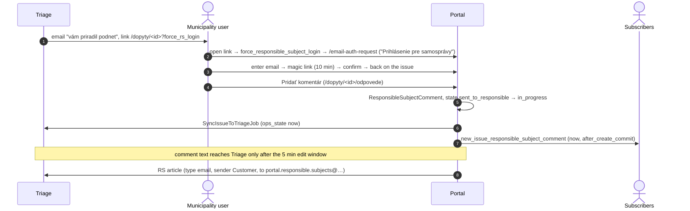
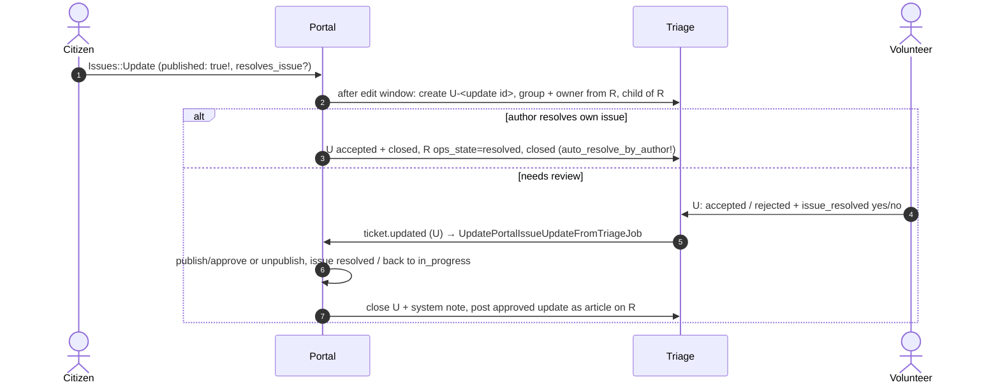

# 04 Resolution (R-ticket)

Starts when the volunteer accepts (see [03](03-submission-and-triage.md#2b-accept-observed)).
The issue becomes public as `sent_to_responsible`.

## 1. Basic RS: email, then the portal (observed)

Observed: comment at 01:03:39 → `in_progress` in Triage 01:03:41; article
sync scheduled 01:08:39.

The RS can also **reply to the email**. The Triage postmaster filter
(`ops-triage-zammad/zammad/app/models/ops/identify_responsible_subject_sender.rb`)
matches `#R?-?(\d{5,6})` in the subject, checks that the sender is in the
organization named like the RS, and files the mail as a Customer article from
`ops-rs-<id>`. Trigger 150 then sets `in_progress`. Inbound email is not set up
locally, so this path can't be clicked through.

### force_rs_login edge cases (observed)

- A logged-in **citizen** opening the link is sent to the RS login page while
  still logged in as the citizen. The header shows the citizen's name.
- On the confirmation page `/email-auth`, the header already shows the RS
  account's name before you click "Prihlásiť".
- `session[:force_rs_login]` is never cleared, so later "login without
  password" pages keep the RS heading.
- An RS user of a **different** RS opening the link is let through
  (`current_user.responsible_subject` present) but can't act, because
  `ensure_responsible_subject` compares RS ids.

## 2. RS actions in the portal

| Action | Route | Effect | Sync |
|---|---|---|---|
| Comment | `POST /dopyty/:id/odpovede` | `ResponsibleSubjectComment`; `sent_to_responsible` → `in_progress` | state now, text after 5 min |
| Mark resolved | same, `resolves=true` | `marked_as_resolved` | state now. Triage 800 adds the public note "čaká na schválenie" |
| Odstúpiť → reassign | `POST /dopyty/:id/odstupenie` `change_type=reassignment` | new RS + `sent_to_responsible` | `SyncIssueToTriageJob` + RS-email article. Triage 200 emails the new RS; 800 note |
| Odstúpiť → refer | same, `change_type=refer` | `referred` | same, no new RS |

Reassign and refer are blocked when the issue is resolved, archived, or
discussion is closed (`issues_responsible_subject_changes_controller.rb:65-67`).
No portal email goes out for a reassign or refer:
`PublishNewIssueCommentJob` has no branch for `ResponsibleSubjectChange`.

## 3. Volunteer actions on the R-ticket

Core workflow allows `rejected, sent_to_responsible, in_progress,
marked_as_resolved, resolved, unresolved, closed, referred, duplicate`. Any
change → portal webhook → `UpdatePortalIssueFromTriageJob` → mail to
subscribers for that state ([09](09-emails.md)).

Comment routing on R uses tags, see [06](06-comments-likes-routing.md).

Tags in an RS email (or note) also change state:

| Tag | ops_state | Trigger |
|---|---|---|
| `[[vyriesene]]` `[[vyrieseny]]` `[[vyriešené]]` `[[vyriešaný]]` (typo) | `marked_as_resolved` | 200 "zmena stavu na označený za vyriešený" |
| `[[odstupene]]` `[[odstupeny]]` `[[odstúpené]]` `[[odstúpený]]` | `referred` | 200 "zmena stavu na odstúpený" |

These two triggers call only the portal webhook, not the PRO webhook, so a
PRO Backoffice never hears about these state changes.

## 4. Verification / update (U-ticket)

Citizen "Aktualizovať" or "Označiť za vyriešený" (`/dopyty/:id/aktualizacie`,
max `USER_ISSUE_UPDATE_DAILY_LIMIT`=5/day):

Edge cases:

- The update is created `published: true`, and subscribers are mailed when
  the U-ticket is created, **before** a volunteer approves it. A rejected
  update has already been publicly visible and emailed.
- The UI offers updates only in the resolution process. The controller
  doesn't enforce this.
- Two paths can set `resolved` (author self-resolve and verification
  accept). Which save sends the mail depends on which one changes `state_id`
  first.

## 5. Automatic "Neriešený" after 15 days

Triage scheduler "NEMENIŤ - Neriešený po 15 dňoch od preposlania" (Mon–Fri
9:00): R-tickets in `sent_to_responsible` with `responsible_subject_changed_at`
older than 15 days → public agent note tagged for portal + RS, and
`ops_state=unresolved`. The portal mails `issue_unresolved` to subscribers,
and the RS gets an email. A later RS reply flips it to `in_progress`
(trigger 150).

## 6. Closing

Only a volunteer closes (`closed`), or the Zammad state is set to closed. The
portal has no cron for this.

## Open issues

Known problems in this flow, tracked in the private `slovensko-digital/ops` repo. When one is fixed, update the section above in the same PR and remove its row.

| Issue | Section | Problem |
|---|---|---|
| [ops#1321](https://github.com/slovensko-digital/ops/issues/1321) | [2. RS actions in the portal](#2-rs-actions-in-the-portal) | An RS reassign / refer appears twice on the portal and mails the wrong email; no own email for an RS change |
| [ops#1332](https://github.com/slovensko-digital/ops/issues/1332) | [force_rs_login edge cases (observed)](#force_rs_login-edge-cases-observed) | `force_rs_login` with a logged-in citizen; session flag never cleared |
| [ops#1334](https://github.com/slovensko-digital/ops/issues/1334) | [3. Volunteer actions on the R-ticket](#3-volunteer-actions-on-the-r-ticket) | Tag-driven states never reach Backoffice; tag typo |
| [ops#1335](https://github.com/slovensko-digital/ops/issues/1335) | [4. Verification / update (U-ticket)](#4-verification--update-u-ticket) | A citizen update is public and mailed before approval |
| [ops#1337](https://github.com/slovensko-digital/ops/issues/1337) | [1. Basic RS: email, then the portal (observed)](#1-basic-rs-email-then-the-portal-observed) | Postmaster filter misses ticket ids < 10000 and > 999999 |
