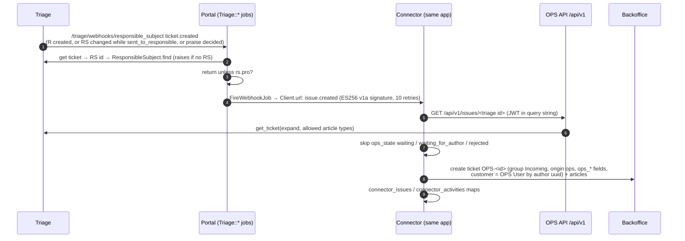

# 07 Backoffice (PRO) via the Connector

Clicked through on 2026-10-15 with portal + Triage + Backoffice running
locally, and Rajec connected as a PRO municipality (tenant 3). Steps marked
**(observed)** were reproduced; the rest is from code. All Connector jobs
except the subtask job have **no tests**.

## Observed end to end (OPS-300305)

| Step | What happened | Jobs |
|---|---|---|
| Citizen submits in Rajec while Triage is down | `SyncIssueToTriageJob` failed (connection refused) and retried; the T-ticket appeared on attempt 4, about 3.5 min later | `SyncIssueToTriageJob` ×4 |
| Volunteer accepts | R-300305 → PRO webhook → Backoffice ticket `OPS-300305` in group Incoming, no owner. `ops_responsible_subject_changed_at` empty ([ops#1338](https://github.com/slovensko-digital/ops/issues/1338)). `podatelna@rajec.sk` **also** got the basic RS email, because Rajec still has its Externý email user | `SendNewIssueFromTriageToBackofficeJob` → `FireWebhookJob` → `CreateNewBackofficeIssueFromTriageJob` |
| Staff posts a public note | Triage note as `ops-rs-30` → trigger 150 `in_progress` → portal `ResponsibleSubjectComment` + mail → Backoffice state updated to "V riešení" once (no loop). `podatelna@rajec.sk` got an email about its own comment | `ProcessNewBackofficeArticleJob` → `SendNewActivityToTriageFromBackofficeJob` → … → `UpdateBackofficeIssueFromTriageJob` |
| Staff hands off to Trnava | Triage R: RS Trnava, `previous_responsible_subject` Rajec, `sent_to_responsible`; portal followed. Backoffice ticket → pending close +5 days. The RS value from Backoffice is stored as the string `"20"`; the portal and 700 rules write integers | `UpdateTriageIssueFromBackofficeJob` → `SyncTicketUpdateFromTriageJob` → `SyncPreviousResponsibleSubjectJob` |
| …new RS is `pro` but has no `Client` | both PRO jobs raise "No clients found for responsible subject: Trnava" and retry until discarded | `SendNewIssue(Update)FromTriageToBackofficeJob` |
| Staff writes subtasks | parsed fine from real editor markup. Every subtask job failed "Not authorized": the tech account has no access to group "Podúlohy" (see below) | `CreateNewBackofficeSubtasksFromArticleJob` → `CreateNewBackofficeSubtaskJob` |

## Wiring

- One `Client` (portal side) per PRO RS holds the webhook signing key, the API
  public key and `url` = Connector webhook URL.
- One `Connector::Tenant` holds the Backoffice URL/token/webhook secret, the
  OPS API private key, and `ops_api_subject_identifier == client.id`.
- `ResponsibleSubject#pro?` gates every Triage → Backoffice job.

Setup: `responsible_subjects:activate_pro`, see [08](08-onboarding.md#pro-municipality-responsible_subjectsactivate_pro).
Locally: README "Local Backoffice".

## Issue list (`GET /api/v1/issues`)

The Connector doesn't call it. It lists the issues whose current RS is the
client's (an issue handed off to another RS drops out) as
`triage_identifier` (R-ticket, omitted without one), `ops_issue_identifier`
and `ops_state`, optionally filtered by `ops_state`.

| Param | Returns |
|---|---|
| none | issues public on the portal (`Issue.publicly_visible`), except `archived` ones |
| `all=true` | the above plus `Issue.past_triage`: issues with an R-ticket in any state (rejected, duplicate, …, legacy ones too), archived legacy issues that passed triage in the old system, and accepted praises, private ones (`resolved_private`) too |

Neither list has issues with a T-ticket but no R-ticket (still in triage, or
rejected or duplicate there), praises not accepted, or new issues waiting for
their first sync to Triage.

Legacy issues posted before 2020 (or in an archived municipality or district)
were imported with state `archived` and their old state in `archived_state`,
and are never sent to Triage. `all=true` leaves out those whose
`archived_state` is `waiting`, `rejected` (the old "Neprijatý") or
`duplicate`, or missing: they never passed triage in the old system. The
portal still shows all of them, because `archived` is a public state.

## Triage → Backoffice



| Triage event (trigger) | Portal job | Connector job | Backoffice effect |
|---|---|---|---|
| 200 "nových podnetov PRO" / "novej pochvaly PRO" → ticket.created | `SendNewIssueFromTriageToBackofficeJob` | `CreateNewBackofficeIssueFromTriageJob` | new `OPS-` ticket |
| 200 "upravených podnetov PRO" → ticket.updated | `SendNewIssueUpdateFromTriageToBackofficeJob` (current RS only) | `UpdateBackofficeIssueFromTriageJob` | ops_state, RS, rs_changed_at, likes, categories, address. Creates the ticket if missing. Zammad `state` untouched |
| 200 "nových komentárov PRO" → article.created | `ProcessNewActivityFromTriageJob` | `CreateNewBackofficeActivityFromTriageJob` (customer activities only if `receive_customer_activities`) | public note, sender Customer |

## Backoffice → Triage / portal

| Backoffice trigger | Portal endpoint | Job | Effect |
|---|---|---|---|
| "OPS - ticket updated" (not by tech user; ops_state / RS / investment changed) | `/connector/backoffice/webhook` | `UpdateTriageIssueFromBackofficeJob` → OPS API PUT → `update_ticket!` | Triage ops_state, RS (+ `previous_responsible_subject`), investment → portal via webhook |
| same | same | `UpdateSubtaskFromParentTicketJob` | copies the parent address to subtasks |
| "OPS - article created" (note on an ops ticket, not by tech user) | same | `ProcessNewBackofficeArticleJob` | `[[podulohy]]` → subtasks; else, if public → `SendNewActivityToTriageFromBackofficeJob` → OPS API POST activity → Triage public note as `ops-rs-<id>` → portal `ResponsibleSubjectComment` |

Backoffice staff roles:

| Role | Can do |
|---|---|
| Agent | internal notes only on OPS tickets; every OPS field is read-only |
| Správca podnetov pre OPS | public notes (→ portal), `ops_state` ∈ {sent_to_responsible, in_progress, marked_as_resolved, referred, unresolved}, change RS |

A hand-off to another RS forces `sent_to_responsible`, and a trigger sets
pending close +5 days. Nobody in Backoffice can set resolved, closed or
rejected. "Resolved" comes only through the portal verification.

## Loop guards (all implicit)

- Backoffice → Triage → Backoffice stops because the Backoffice trigger
  ignores updates by the tech user.
- Triage → portal stops because nothing on the portal `Issue` pushes back
  to Triage on save.
- An RS comment isn't echoed back to its own Backoffice because of the
  article-type allowlist.

If someone edits the "NEMENIŤ" triggers in the Zammad UI (which loses
`pre_condition` params), loops become possible.

## Subtasks (podúlohy)

Backoffice only. Triage has no subtasks: `::po`, `[[podulohy]]` and
`@@user … - date` mean nothing there, and a volunteer who writes them gets a
plain note. In Backoffice, write a note (internal is fine):

```
::po            ← text module "OPS - Vytvorenie podúloh" inserts [[podulohy]]
[[podulohy]]
@@Ján Novák - skontrolovať stĺp - 31.12.2026
@@Eva Malá - objednať opravu
```

Observed in the desktop UI:

- `::po` matches **two** text modules. The highlighted default is
  "OPS - Verejný komentár pre odkazprestarostu" (its keywords `portal`/`ops`
  start with "po"), so pressing Enter inserts `[[ops portal]]` instead of
  `[[podulohy]]`.
- With plain Enter between lines, the editor stores
  `[[podulohy]]<br><a … data-mention-user-id="6">Agent Example</a>&nbsp;- skontrolovat vytlk - 31.12.2026<br>…`.
  The parser handles this: `[^-]*` swallows the `&nbsp;`, and both lines
  were queued.
- Every `CreateNewBackofficeSubtaskJob` then failed with "Not authorized".
  Group "Podúlohy" is created by the rake on deploy, but the tech account's
  role gets new groups only from the scheduler "OPS - add all groups to tech
  role." (every 15 min). The rake re-creates that scheduler with
  `last_run: Time.zone.now` on every container start
  (`ops-backoffice-saas/zammad/lib/tasks/ops/backoffice.rake:1195-1204`), so
  each deploy restarts the 15-minute wait. Retries give up after about 6
  minutes (5 attempts), so subtasks written soon after a deploy or a new
  group are **lost silently**. The note itself is never forwarded anywhere,
  so nobody notices.

`Connector::SubtaskParser` (`app/lib/connector/subtask_parser.rb`) takes the
text after the **last** `[[podulohy]]`, splits it on `<br>`, and needs
`<mention> - title [- DD.MM.YYYY]` per line. For each line
`ZammadApiClient#create_subtask` creates `SUB-<parent>-<article>-<n>` in group
"Podúlohy": owner = the mentioned agent, customer = the note author, a copy of
the first article and **all parent attachments**. A due date → pending
reminder at 08:00 (server TZ). It also adds a checklist item to the parent.

Parsing edge cases (probed against the regex):

| Input | Result |
|---|---|
| lines in `<div>`/`<p>` instead of `<br>` | only the first subtask; the date is swallowed into the title |
| `&nbsp;-&nbsp;date` after a mention | date lost, kept in the title |
| text after the date | date lost |
| `yyyy-mm-dd` | not recognised |
| two mentions on one line | title contains raw HTML |
| no ` - ` after the mention, or invalid date | line silently dropped |
| assignee without the Agent role | job retries until it gives up |

Subtask state is never synced back. A note carrying `[[podulohy]]` is
**never** forwarded to Triage or the portal, even if public. Subtasks have
`origin: subtask`, which isn't a valid select option, so the UI shows a
blank origin.

## Known gaps

- Hand-off away from a PRO RS: only the new RS's Backoffice is told; the
  old one keeps a stale ticket but can still update it through
  `previous_responsible_subject`.
- `referred` / `marked_as_resolved` set by tags in Triage never reach
  Backoffice.
- The OPS API `show` never fills `responsible_subject_changed_at` or
  `resolution_started_at`, so Backoffice `ops_responsible_subject_changed_at`
  is always empty.
- `UpdateTriageIssueFromBackofficeJob` and `UpdateSubtaskFromParentTicketJob`
  crash (5 retries) on Backoffice tickets the Connector didn't create:
  manual tickets, subtasks, and the seeded sample ticket.
- Backoffice owner, group or internal state never reach Triage or the portal.

## Open issues

Known problems in this flow, tracked in the private `slovensko-digital/ops` repo. When one is fixed, update the section above in the same PR and remove its row.

| Issue | Section | Problem |
|---|---|---|
| [ops#1326](https://github.com/slovensko-digital/ops/issues/1326) | [Subtasks (podúlohy)](#subtasks-podúlohy) | Backoffice subtasks are lost after a deploy |
| [ops#1327](https://github.com/slovensko-digital/ops/issues/1327) | [Observed end to end (OPS-300305)](#observed-end-to-end-ops-300305) | Sync jobs give up after ~6 minutes, nothing re-syncs |
| [ops#1333](https://github.com/slovensko-digital/ops/issues/1333) | [Known gaps](#known-gaps) | A hand-off away from a PRO RS doesn't reach the old Backoffice |
| [ops#1333](https://github.com/slovensko-digital/ops/issues/1333) | [Triage → Backoffice](#triage--backoffice) | A hand-off away from a PRO RS doesn't reach the old Backoffice |
| [ops#1338](https://github.com/slovensko-digital/ops/issues/1338) | [Known gaps](#known-gaps) | OPS API: missing fields in `show`, crashes on unknown category / client without RS, double render |
| [ops#1339](https://github.com/slovensko-digital/ops/issues/1339) | [Backoffice → Triage / portal](#backoffice--triage--portal) | Connector jobs crash on Backoffice tickets the Connector didn't create |
| [ops#1340](https://github.com/slovensko-digital/ops/issues/1340) | [Subtasks (podúlohy)](#subtasks-podúlohy) | Subtask authoring is fragile (`::po` text module, parser) |
| [ops#1343](https://github.com/slovensko-digital/ops/issues/1343) | [Observed end to end (OPS-300305)](#observed-end-to-end-ops-300305) | A PRO RS with Externý email users gets everything twice |
| [ops#1344](https://github.com/slovensko-digital/ops/issues/1344) | [Wiring](#wiring) | A PRO RS without a `Client` breaks every PRO job |
| [ops#1348](https://github.com/slovensko-digital/ops/issues/1348) | [Observed end to end (OPS-300305)](#observed-end-to-end-ops-300305) | RS value is an integer or a string depending on who wrote it |
