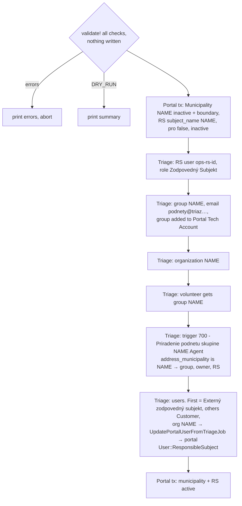

# 08 Onboarding municipalities and users

## Basic municipality: `responsible_subjects:activate_basic`

```
bin/rails responsible_subjects:activate_basic \
  BOUNDARY_ID=… NAME="Rajec" DISTRICT="Žilinský" \
  USERS="podatelna@rajec.sk,jan.novak@rajec.sk" \
  TRIAGE_ZAMMAD_AGENT_EMAIL=volunteer@… [DRY_RUN=1]
```

Needs `TRIAGE_ZAMMAD_ADMIN_API_TOKEN`. Code:
`lib/tasks/responsible_subjects.rake`,
`app/models/responsible_subjects/basic_activation.rb`. Tested in
`test/models/responsible_subjects/basic_activation_test.rb`; the rake wrapper
is not tested.



What it refuses, and why:

- **A municipality that already exists in any state.** An existing RS may
  already have issues in the portal. Those issues would have to be imported
  into Triage first, which needs Triage `import_mode` and downtime. The task
  doesn't do that, so it supports only new municipalities.
- An RS with the same `subject_name`, emails already used by an RS user or
  existing in Triage, a group/organization/trigger with the same name.

What it doesn't handle:

- **No rollback for Triage.** If step C–G fails, the portal still has the
  inactive municipality, and Triage has a partial setup. A re-run fails
  validation on the already-created group or organization. The cleanup is
  manual.
- City parts (`Mesto::Časť`). The 700 condition is an exact match on the
  municipality name.
- PRO setup, see [`activate_pro`](#pro-municipality-responsible_subjectsactivate_pro) and
  [`upgrade_to_pro`](#basic-to-pro-responsible_subjectsupgrade_to_pro).

### Locally: `EXISTING_MUNICIPALITY=1`

The dev seeds create Banská Bystrica, Trnava, Nitra, Malacky and Pezinok and
their RS inactive. `EXISTING_MUNICIPALITY=1` (development only, the task
aborts elsewhere) activates such a municipality instead of refusing it:
step A reuses the municipality and the RS named NAME, links the boundary to
it, and sets the RS email to the first of USERS and `pro` false. The rest is
the same. `BOUNDARY_ID` and `DISTRICT` default to the municipality's own. It
refuses an active or archived municipality, a missing or active RS, and an
RS that already has a Triage user. The municipality's seeded issues are not
sent to Triage.
`bin/activate-seeded-municipalities` runs it for every seeded inactive
municipality, see "Local Triage" in the README.

## PRO municipality: `responsible_subjects:activate_pro`

```
bin/rails responsible_subjects:activate_pro \
  BOUNDARY_ID=… NAME="Stupava" DISTRICT="Bratislavský" \
  TRIAGE_ZAMMAD_AGENT_EMAIL=volunteer@… \
  BACKOFFICE_URL=https://stupava.odkazprestarostu.sk/ [DRY_RUN=1]
```

For a new municipality, like `activate_basic`, with the same checks on the
boundary, the district, the agent and an existing municipality, RS, group,
organization or trigger. It also refuses a `Connector::Tenant` named NAME,
and points an active BASIC RS to `upgrade_to_pro`. Code:
`app/models/responsible_subjects/pro_activation.rb`, tested in
`test/models/responsible_subjects/pro_activation_test.rb`.

1. Portal: municipality NAME and RS NAME as `activate_basic` does, with
   `pro` true and no email (step A above).
2. Triage: RS user, group NAME for the volunteer and the 700 trigger
   (steps B, C, E and F above). No organization and no users, the
   municipality works its tickets in the Backoffice, so Triage emails nobody.
3. Portal: `Client` and `Connector::Tenant` (`BACKOFFICE_URL`,
   `CONNECTOR_WEBHOOK_URL`, generated keys, `API_TOKEN` and `WEBHOOK_SECRET`
   generated unless passed), then the municipality and the RS active.

It prints the Backoffice's environment (`OPS_RESPONSIBLE_SUBJECT(_ID)`,
`WEBHOOK_TENANT_ID`, `API_TOKEN`, `WEBHOOK_SECRET`, `OPS_CONNECTOR_URL`),
deploy the Backoffice with it. `EXISTING_MUNICIPALITY=1` works as for
`activate_basic`. Like `activate_basic`, Triage changes are not rolled back
when a step fails.

## Basic to PRO: `responsible_subjects:upgrade_to_pro`

```
bin/rails responsible_subjects:upgrade_to_pro NAME="Malacky" \
  BACKOFFICE_URL=https://malacky.odkazprestarostu.sk/ [DRY_RUN=1] [YES=1]
```

For an active BASIC RS (found by `subject_name`) with its Triage user, group
and 700 trigger. It refuses a PRO or inactive RS, an RS with an active
`Client`, and a `Connector::Tenant` named NAME other than the one a downgrade
disabled. It lists the changes and asks to confirm them (`YES=1` skips it).
Code: `app/models/responsible_subjects/pro_upgrade.rb`, tested in
`test/models/responsible_subjects/pro_upgrade_test.rb`.

1. Triage: keeps the RS user, group NAME and the 700 trigger as they are,
   including the volunteer the trigger assigns tickets to.
2. Triage: takes every user of organization NAME out of it, role Externý
   zodpovedný subjekt becomes Customer, so Triage no longer emails them about
   the municipality's tickets (ops#1343), then deletes the organization. When
   Zammad refuses (tickets still belong to it), it logs that and goes on.
   Each user goes through `UpdatePortalUserFromTriageJob` right away, so the
   portal makes them `User::Citizen` even when Triage's `user.updated` webhook
   doesn't reach it. Their RS comments stay, they belong to the RS, not to
   the user. The users stay in Triage and in the portal, what should happen
   to them is not decided yet.
3. Portal: `Client` and `Connector::Tenant` as `activate_pro` does, or enables
   the ones a downgrade disabled, with the new URL, token and secret. The
   Tenant keeps its id (`WEBHOOK_TENANT_ID`) and its `Connector::Issue`s.
   Sets `pro` on the RS.

It prints the Backoffice's environment like `activate_pro`.

## PRO to basic: `responsible_subjects:downgrade_to_basic`

```
bin/rails responsible_subjects:downgrade_to_basic NAME="Malacky" \
  USERS="podatelna@malacky.sk,jan.novak@malacky.sk" [DRY_RUN=1] [YES=1]
```

For an active PRO RS with an active `Client`, its Triage group and 700
trigger, and no organization NAME in Triage. The municipality's tickets are
all in Triage, the Backoffice had copies, so nothing moves back. It refuses a
user of USERS who is in a Triage organization or is a user of another RS in
the portal. It lists the changes and asks to confirm them (`YES=1` skips it).
Code: `app/models/responsible_subjects/pro_downgrade.rb`, tested in
`test/models/responsible_subjects/pro_downgrade_test.rb`.

1. Triage: keeps the RS user, group NAME and the 700 trigger.
2. Triage: organization NAME and its users as `activate_basic` does (step G
   above). A user already in Triage, e.g. a Customer left by the upgrade,
   joins the organization instead and keeps its other roles.
3. Portal: disables the `Client` (`active` false, the API refuses its tokens)
   and the `Connector::Tenant` (`inactive`, the Connector webhooks refuse it),
   sets `pro` false and the RS email to the first of USERS. A later
   `upgrade_to_pro` enables them again.

Stop the Backoffice after the downgrade.

### Locally

`bin/activate-seeded-municipalities` activates Malacky with `activate_pro
EXISTING_MUNICIPALITY=1` and, if asked, Trnava with `activate_basic` and then
`upgrade_to_pro`, each with a Backoffice of `ops-backoffice-saas` `dev/up`, see
"Local Backoffice" in the README.

## A volunteer leaves

Their 700 triggers and tickets go to other volunteers with the Triage rake tasks
[`ops:owner_handover`](https://github.com/slovensko-digital/ops-triage-zammad/blob/main/zammad/lib/tasks/ops/owner_handover.rake).

## Users across systems

A user is created either in the portal (citizen registration) or in Triage
(an agent adds them, e.g. when onboarding an RS). The portal sends a user to
Triage on their first activity, and Triage sends changes back through the
`user.updated` webhook → `Triage::UpdatePortalUserFromTriageJob`. There are no
agreed rules for the resulting state of a user in both systems, so the table
below describes what the code does today, gaps included. Deciding those rules
is the epic [ops#1350](https://github.com/slovensko-digital/ops/issues/1350).

| Event | Where it starts | Effect |
|---|---|---|
| Citizen registers (password / Google / Facebook) | Portal (Rodauth) | `User::Citizen`; email verify; onboarding; SMS phone verification (AWS) for full access |
| Citizen's first issue | Portal → Triage | customer `ops-user-<id>`, role Portal User, `origin=portal` |
| Citizen renames | Portal | `SyncUserUpdateToTriageJob` + `SyncUserUpdateToBackofficeJob` (all active tenants) |
| Citizen closes account | Portal | `User#anonymize!` changes `firstname`, which fires the rename sync: the Triage customer becomes "Anonym …" with an empty last name (`zammad_api_client.rb:523-530`). Their articles in Triage (including the original description) stay |
| Volunteer bans a user | Triage user `banned` → `user.updated` | portal `banned`, and `check_banned_user` logs them out. Only for Triage users with `origin=portal` (citizens). RS users created in Triage (`create_user!`) have no `origin`, so the ban is not copied and they keep logging in |
| Volunteer deactivates a user | Triage user `active` → `user.updated` | nothing. The job ignores `active` |
| User added to an organization named like an RS | Triage → `user.updated` | only the organization counts, the Triage role is ignored. The portal user (matched by `external_id`, then by email) becomes or is created as `User::ResponsibleSubject` (verified, onboarded, random password, magic-link login only). First name, last name and email are copied from Triage. A user matched by email keeps its old `external_id` |
| Portal citizen added to that organization | Triage → `user.updated` | same as above. The citizen's Triage customer has `firstname = display_name`, no last name and no email, so the portal name is mangled and the email is overwritten with an empty value unless the agent fills it in. Password login stops working without notice |
| User removed from that organization | Triage → `user.updated` | back to `User::Citizen`. Their RS comments and subscriptions stay as they are |
| Name or email changed in Triage | Triage → `user.updated` | copied only while the user is in an RS organization. Citizens are not updated |
| RS user edits their profile | Portal | `SyncUserUpdateToTriageJob` looks up the login `ops-user-<id>` only. RS users created in Triage have their email as login, so nothing is synced |
| RS renamed | — | `subject_name` is the join key to the Triage organization and the `responsible_subject` label. A rename breaks the email recipients and the RS user mapping |

## Open issues

Known problems in this flow, tracked in the private `slovensko-digital/ops` repo. When one is fixed, update the section above in the same PR and remove its row.

| Issue | Section | Problem |
|---|---|---|
| [ops#1341](https://github.com/slovensko-digital/ops/issues/1341) | [Basic municipality: `responsible_subjects:activate_basic`](#basic-municipality-responsible_subjectsactivate_basic) | `activate_basic` has no Triage rollback |
| [ops#1343](https://github.com/slovensko-digital/ops/issues/1343) | [Basic to PRO: `responsible_subjects:upgrade_to_pro`](#basic-to-pro-responsible_subjectsupgrade_to_pro) | A PRO RS with Externý email users gets everything twice. `upgrade_to_pro` removes them, PRO municipalities set up by hand before it may still have them |
| [ops#1347](https://github.com/slovensko-digital/ops/issues/1347) | [PRO municipality: `responsible_subjects:activate_pro`](#pro-municipality-responsible_subjectsactivate_pro) | Backoffice `API_TOKEN` rotation is ignored after the first deploy |
| [ops#1350](https://github.com/slovensko-digital/ops/issues/1350) | [Users across systems](#users-across-systems) | Epic: no agreed sync rules for users between the portal and Triage, so bans, deactivation, organization and role changes leave inconsistent data |
| [ops#1315](https://github.com/slovensko-digital/ops/issues/1315) | [Users across systems](#users-across-systems) | An RS user deactivated in Triage can still log in to the portal |
| [ops#1304](https://github.com/slovensko-digital/ops/issues/1304) | [Users across systems](#users-across-systems) | An RS comment crashes when the RS has no `external_id` in Triage |
| [ops#1306](https://github.com/slovensko-digital/ops/issues/1306) | [Users across systems](#users-across-systems) | The "user already exists" fallback never runs on a duplicate Triage login |
