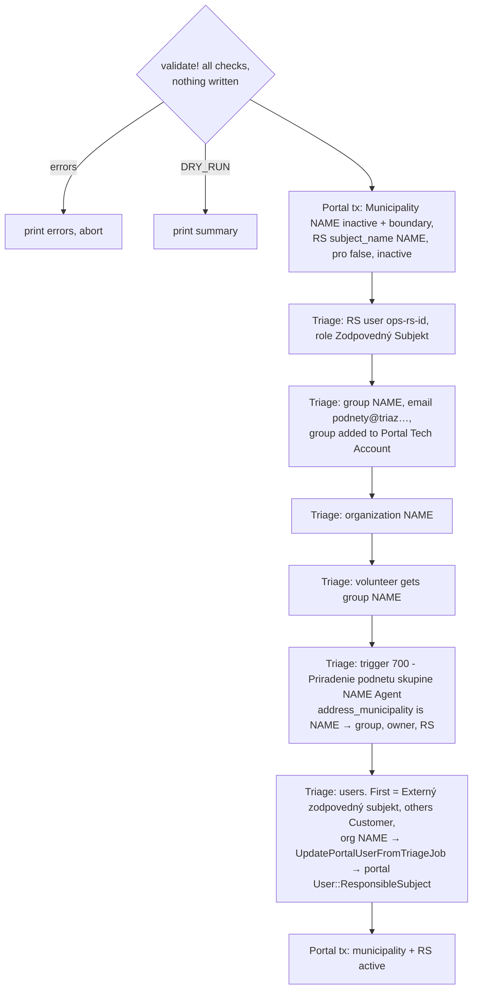

# 08 Onboarding municipalities and users

## Basic municipality: `responsible_subjects:activate_basic`

```
bin/rails responsible_subjects:activate_basic \
  BOUNDARY_ID=… NAME="Rajec" DISTRICT="Žilinský" \
  USERS="podatelna@rajec.sk,jan.novak@rajec.sk" \
  TRIAGE_ZAMMAD_AGENT_EMAIL=volunteer@… [DRY_RUN=1]
```

Needs `TRIAGE_ZAMMAD_ADMIN_API_TOKEN`. Code:
`lib/tasks/responsible_subjects.rake`,
`app/models/responsible_subjects/basic_activation.rb`. Tested in
`test/models/responsible_subjects/basic_activation_test.rb`; the rake wrapper
is not tested.



What it refuses, and why:

- **A municipality that already exists in any state.** An existing RS may
  already have issues in the portal. Those issues would have to be imported
  into Triage first, which needs Triage `import_mode` and downtime. The task
  doesn't do that, so it supports only new municipalities.
- An RS with the same `subject_name`, emails already used by an RS user or
  existing in Triage, a group/organization/trigger with the same name.

What it doesn't handle:

- **No rollback for Triage.** If step C–G fails, the portal still has the
  inactive municipality, and Triage has a partial setup. A re-run fails
  validation on the already-created group or organization. The cleanup is
  manual.
- City parts (`Mesto::Časť`). The 700 condition is an exact match on the
  municipality name.
- PRO setup.

## PRO municipality: Backoffice

Manual: deploy a Backoffice with env `WEBHOOK_TENANT_ID`,
`OPS_RESPONSIBLE_SUBJECT(_ID)`, `API_TOKEN`, `WEBHOOK_SECRET`,
`OPS_CONNECTOR_URL`, then run the `connect_backoffice` snippet from the
README in a portal console. It sets `pro: true` and creates the `Client` and
`Connector::Tenant`. Nothing creates a Triage routing rule for a PRO
municipality. Routing them is the "750" admin-made rules, which live only in
the Triage database.

## Users across systems

| Event | Where it starts | Effect |
|---|---|---|
| Citizen registers (password / Google / Facebook) | Portal (Rodauth) | `User::Citizen`; email verify; onboarding; SMS phone verification (AWS) for full access |
| Citizen's first issue | Portal → Triage | customer `ops-user-<id>`, role Portal User, `origin=portal` |
| Citizen renames | Portal | `SyncUserUpdateToTriageJob` + `SyncUserUpdateToBackofficeJob` (all active tenants) |
| Citizen closes account | Portal | `User#anonymize!` changes `firstname`, which fires the rename sync: the Triage customer becomes "Anonym …" with an empty last name (`zammad_api_client.rb:523-530`). Their articles in Triage (including the original description) stay |
| Volunteer bans a user | Triage user `banned` → `user.updated` | portal `banned`; `check_banned_user` logs them out |
| User added to an organization named like an RS | Triage → `user.updated` | portal user becomes or is created as `User::ResponsibleSubject` (verified, onboarded, random password, magic-link login only) |
| User removed from that organization | Triage → `user.updated` | back to `User::Citizen` |
| RS renamed | — | `subject_name` is the join key to the Triage organization and the `responsible_subject` label. A rename breaks the email recipients and the RS user mapping |

## Open issues

Known problems in this flow, tracked in the private `slovensko-digital/ops` repo. When one is fixed, update the section above in the same PR and remove its row.

| Issue | Section | Problem |
|---|---|---|
| [ops#1341](https://github.com/slovensko-digital/ops/issues/1341) | [Basic municipality: `responsible_subjects:activate_basic`](#basic-municipality-responsible_subjectsactivate_basic) | `activate_basic` has no Triage rollback |
| [ops#1343](https://github.com/slovensko-digital/ops/issues/1343) | [PRO municipality: Backoffice](#pro-municipality-backoffice) | A PRO RS with Externý email users gets everything twice |
| [ops#1347](https://github.com/slovensko-digital/ops/issues/1347) | [PRO municipality: Backoffice](#pro-municipality-backoffice) | Backoffice `API_TOKEN` rotation is ignored after the first deploy |
