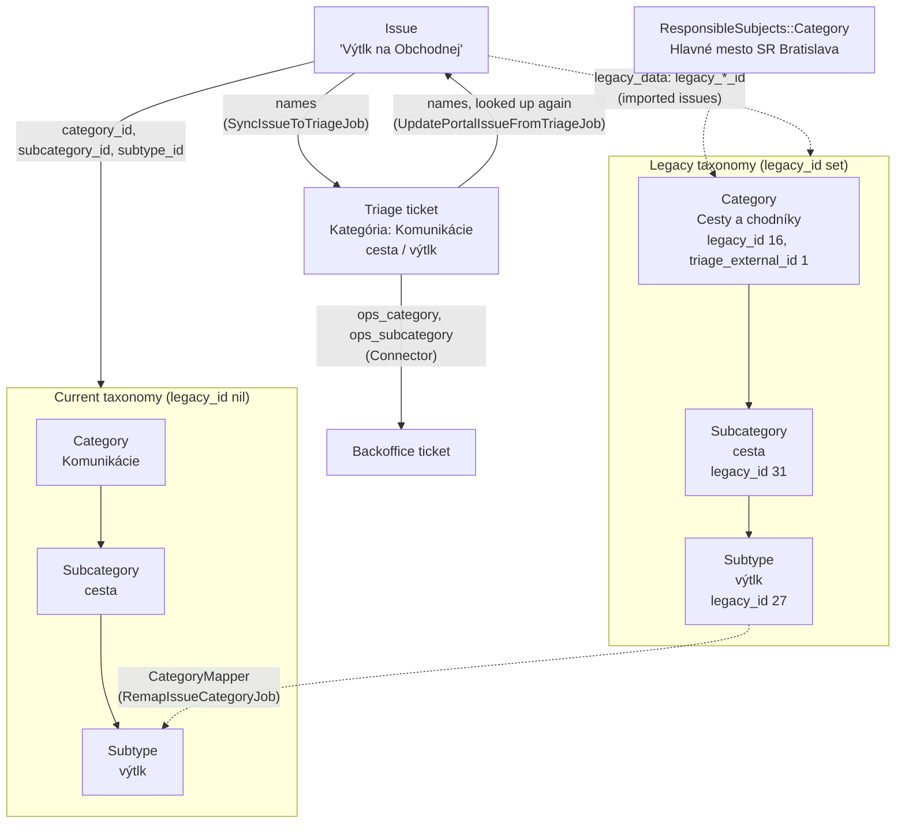

# 11 Data model

What the main models are and how they relate. One section per area, each with a
short table of models and a diagram with an example.

| Section | Models |
|---|---|
| [Categories](#categories) | `Issues::Category`, `Issues::Subcategory`, `Issues::Subtype`, `ResponsibleSubjects::Category`, legacy rows |

## Categories

An issue is classified with three levels: **category → subcategory → subtype**
(e.g. *Komunikácie → cesta → výtlk*). The portal stores the tree in its own
tables. Triage and Backoffice keep their own copy as select options and the
apps match each other by **name**.

### Models

| Model | Table | What it is |
|---|---|---|
| `Issues::Category` | `issues_categories` | Top level, e.g. *Komunikácie*. Shown as the first wizard step ([03](03-submission-and-triage.md)) |
| `Issues::Subcategory` | `issues_subcategories` | Second level, belongs to a category, e.g. *cesta* |
| `Issues::Subtype` | `issues_subtypes` | Third level, belongs to a subcategory, e.g. *výtlk*. Optional, some subcategories have none (*iné*) |
| `Issue` / `Issues::Draft` | `issues`, `issues_drafts` | Point at one row of each level: `category_id`, `subcategory_id`, `subtype_id`. Category is required except for praise |
| `ResponsibleSubjects::Category` | `responsible_subjects_categories` | Which RS handled which **legacy** category in the old system. Imported once, nothing reads it today |
| "legacy" | `legacy_id` column on all of the above | Row imported from the old system. `legacy_id` is the old system's id. `nil` means current taxonomy |

Not related: `Cms::Category` is a Discourse category for CMS pages.

### Two taxonomies in one table

- **Current** (`legacy_id: nil`, scope `non_legacy`): 18 categories. The
  wizard and the AI suggestion prompt (`Ai::Prompt.generate_categories_table`)
  only offer these.
- **Legacy** (`legacy_id` set): the 8 old categories with their subtrees,
  imported by the removed `Import::Issues::ImportCategoriesJob`.
  `Issues::RemapIssueCategoryJob` moved imported issues to current categories
  using the name table in `app/lib/category_mapper.rb` and kept the old ids in
  `issue.legacy_data`.
- Legacy categories also have `triage_external_id` (1-7): Triage stores old
  categories by that number (`OPS_OLD_CATEGORIES_MAP` in
  `ops-triage-zammad/zammad/lib/tasks/ops/triage.rake`), current ones by name.

No code creates or syncs current categories in production. The same tree is
hard-coded in `ops-triage-zammad/.../triage.rake` (`OPS_CATEGORIES_MAP`) and
`ops-backoffice-saas/.../backoffice.rake`. Changing a category means changing
all three.

### How it fits together

Example: a citizen reports a pothole. The wizard offers only current
categories, so the draft gets *Komunikácie → cesta → výtlk*. The issue is
created with those three ids and `SyncIssueToTriageJob` sends the three
**names** to Triage. When a volunteer changes the category in Triage,
`UpdatePortalIssueFromTriageJob` looks the names up again
(`ZammadApiClient#build_issue_ticket_response`). An issue imported from the
old system with *Cesty a chodníky → cesta → výtlk* was remapped to the same
current row; its old ids sit in `legacy_data`.

## Open issues

| Issue | Section | Summary |
|---|---|---|
| — | [Two taxonomies](#two-taxonomies-in-one-table) | *Verejné služby* and *Verejný poriadok* exist both as current and legacy rows. `Issues::Draft` (`draft.rb:148`) and `ZammadApiClient#build_issue_ticket_response` look categories up by name without `non_legacy`, so on production *Verejné služby* resolves to the legacy row (lower id) and new issues end up on it |
